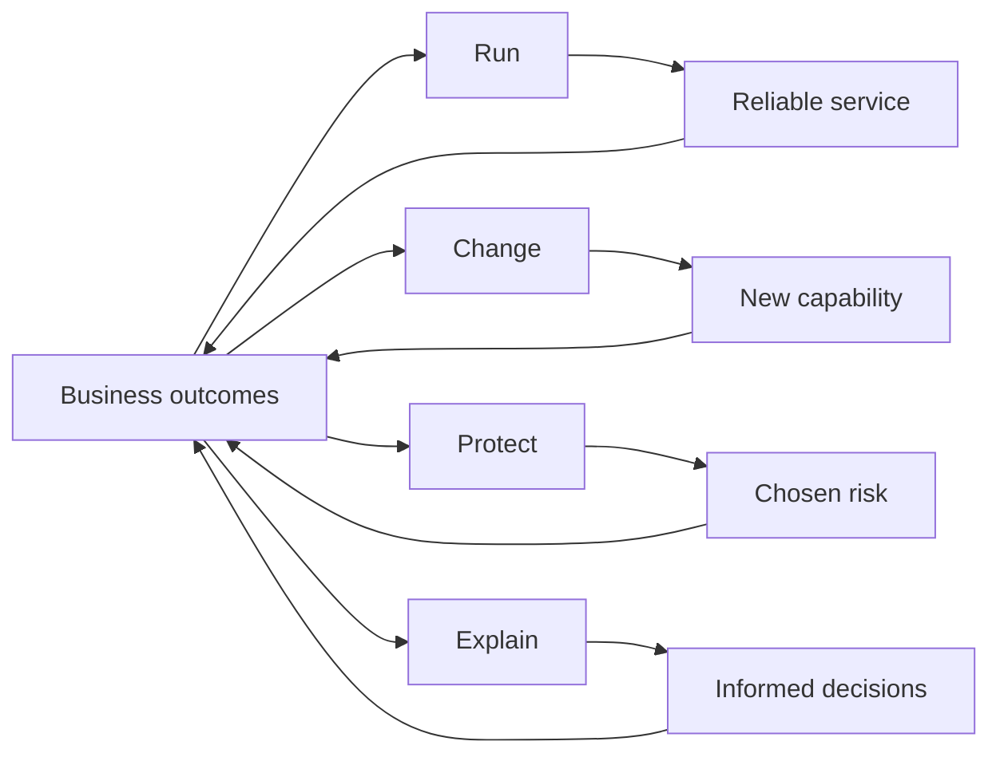
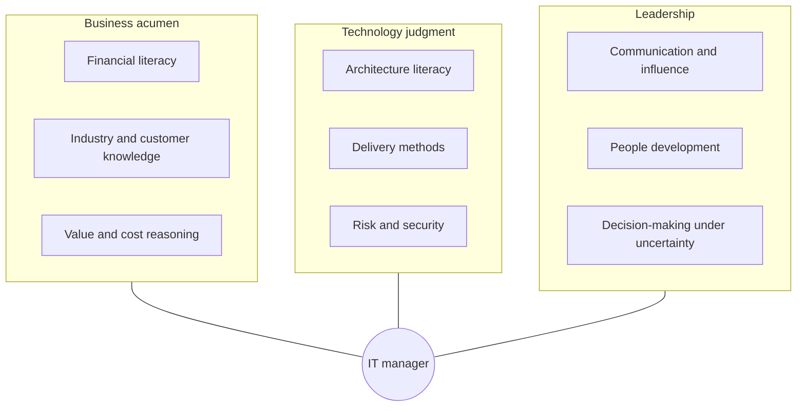

# Chapter 1 — The Evolving Role of the IT Manager

## Learning objectives

By the end of this chapter you will be able to:

1. State your accountability in one sentence that a chief executive would recognize.
2. Distinguish the four accountabilities of IT management — run, change, protect, explain — and identify which one you are currently neglecting.
3. Map your role against the IT leadership spectrum and understand what changes at each level.
4. Diagnose the expert-to-manager transition and apply a delegation ladder that does not collapse under pressure.
5. Build a stakeholder map and an operating rhythm that make your role visible and predictable.
6. Recognize the seven common derailers of IT managers before they derail you.

---

## Opening scenario: forty-two slides and one question

Priya Raman had rehearsed the board presentation for a week. She had forty-two slides: the cloud roadmap, the workload migration curve, the application rationalization plan, a heat map of technical debt, the security remediation backlog. It was, she thought, the most complete picture of Meridian's technology estate that any board had ever seen.

She got eight minutes.

Elena Voss, the chief executive, let her reach slide nine before asking, "Priya, which of these makes us money?"

The room went quiet. Priya started to explain that the migration would reduce run cost by 18% over three years, which would improve EBITDA, which would—

"Over three years," Elena said. "And this year?"

Priya looked at the migration curve. This year the curve was flat, because the first eighteen months were landing zones, network, and identity. She had a slide for that. It was slide thirty-one.

Marcus Feld, the chief financial officer, asked the second question. "You're asking for eleven million in capital. Which division is it for?"

"All three."

"Then how do I allocate it?"

Priya realized, somewhere between slide eleven and the coffee that had gone cold beside her, that she had prepared a technology presentation for a business audience. She had described activity. She had not described accountability.

She left the meeting with her budget deferred, her credibility dented, and a much more useful question than the one she had walked in with: *what is this job, actually?*

---

## Core concepts

### 1.1 The four accountabilities

IT management is the discipline of making technology produce reliable business outcomes at an acceptable cost and an acceptable level of risk.

That sentence contains four words that do most of the work: **reliable**, **outcomes**, **cost**, **risk**. Each maps to an accountability that must be owned by someone, and in a well-run function, by you.

| Accountability | The question it answers | Typical measures | How it fails |
|---|---|---|---|
| **Run** | Does it work, today, for everyone who needs it? | Availability, resolution time, backlog age, user satisfaction | Silent decay; outages that surprise everyone; a service desk that hides its own failure |
| **Change** | Are we becoming more capable, on purpose? | Delivery predictability, adoption, benefit realization | Projects that ship features nobody uses; perpetual programmes; scope that grows to fill the budget |
| **Protect** | Are we carrying only the risk we have chosen to carry? | Control coverage, incident severity, recovery test results, audit findings | Compliance theatre; a register nobody reads; discovery of risk only after it materializes |
| **Explain** | Can the organization make informed decisions about technology? | Decision latency, forecast accuracy, board confidence | Reports that describe activity; costs nobody can allocate; surprises |

Most IT managers are promoted because of **run** competence and are judged on **change**. The two accountabilities that most often go unowned are **protect** and **explain** — and they are the two that end careers.



**In practice:** the four accountabilities are not four jobs. They are four lenses on the same job. When a decision arrives, ask which lens it belongs to, and whether the person proposing it has considered the other three. A cloud migration is a *change* proposal with *run* consequences, *protect* obligations, and an *explain* requirement.

### 1.2 The role spectrum

"IT manager" covers at least six different jobs. Titles vary by organization, and the same title can mean different things in two companies of similar size. What distinguishes the levels is not the amount of work but the **unit of accountability**.

| Level | Accountable for | Typical span | The hard part |
|---|---|---|---|
| **Team lead / supervisor** | A team's output and day-to-day performance | 5–12 people | Letting go of your own delivery work |
| **IT manager** | A function or service: infrastructure, applications, service desk, security operations | 10–40 people, one or more budgets | Balancing run and change with no formal authority over either |
| **Head of IT / IT director** | The whole IT function in a business unit or mid-size company | 40–150 people, multi-million budget | Translating business strategy into a technology agenda |
| **CIO** | Enterprise technology outcomes and the technology P&L | Enterprise-wide | Owning a portfolio of bets, not a set of services |
| **CTO** | Technology direction, architecture, and product engineering | Varies; often customer-facing | Distinguishing durable advantage from fashion |
| **CDIO / Chief Digital Officer** | Business model change enabled by technology | Cross-functional | Changing the operating model, not just the systems |
| **CISO** | Security risk and control effectiveness | Enterprise-wide, often a matrix | Being heard when nothing has gone wrong yet |

Three things change as you move up:

1. **The time horizon lengthens.** A team lead thinks in weeks, a manager in quarters, a director in years, a CIO in a portfolio of years.
2. **The unit of work changes.** From tasks, to services, to portfolios, to bets.
3. **The evidence changes.** From "I delivered it" to "the business changed because of it."

A common mistake at the manager-to-director boundary is continuing to optimize for the previous level's evidence. Priya, in the opening scenario, was still presenting like a Head of Applications: here is what we are building. The board needed a Head of IT answer: here is the outcome, the cost, the risk, and the choice.

### 1.3 From expert to manager: four shifts

The transition is not a promotion of the same skill. It is a change of profession.

| Shift | From | To | What it costs you |
|---|---|---|---|
| **From solving to framing** | Being the person with the answer | Being the person with the question | The discomfort of watching someone solve it worse than you would |
| **From output to outcome** | "I shipped it" | "It changed something" | Losing the clean satisfaction of completion |
| **From authority to influence** | "Because I said so" | "Because we agreed, and here is why" | Needing to persuade people who cannot be instructed |
| **From certainty to judgment** | Being right | Being right often enough, and correcting fast | Living with ambiguity and being accountable for it |

The first shift is the hardest, because it attacks identity. If you have spent ten years being the person who fixes the difficult thing, then delegating the difficult thing feels like losing your value. It is not. Your value has moved: it is now the quality of the framing, the judgment of the person you chose, and the system that lets them succeed.

#### The delegation ladder

Delegation fails when it is all-or-nothing. Use five explicit levels, and say which one applies.

| Level | Name | You say | You retain |
|---|---|---|---|
| 1 | **Do exactly this** | "Run this script, send me the output." | Full control |
| 2 | **Research and report** | "Find out what happened; don't change anything." | The decision |
| 3 | **Recommend** | "Propose an option with trade-offs; I'll decide." | The decision |
| 4 | **Decide and inform** | "Decide, act, and tell me before end of day." | Veto and visibility |
| 5 | **Own it** | "This is yours. Escalate only if the constraints change." | Outcome accountability |

Most managers default to level 1 under stress and level 5 when they are busy. Both are failures. Level 1 burns your time and stunts the team; level 5 without a prior ladder is abandonment dressed as empowerment.

**In practice:** when you delegate, state the level out loud. "I want a recommendation by Thursday — that's level three." It takes four seconds and prevents a week of misalignment.

### 1.4 The competency model

Three axes matter, and they are not equally distributed in most IT managers.



The familiar **T-shaped** model — depth in one area, breadth across many — understates the job. A more accurate shape is a **comb**: several teeth of real depth (you must be able to smell a bad estimate, a fragile architecture, or a dishonest status report) joined by a strong spine of business and leadership competence.

| Competency | Emerging manager | Experienced manager | Senior leader |
|---|---|---|---|
| Financial literacy | Reads a budget | Builds a business case; explains variance | Owns a P&L; allocates capital |
| Technology judgment | Knows the stack | Evaluates options; spots risk | Sets direction; knows when to buy |
| Delivery | Runs a project | Runs a portfolio; fixes failing delivery | Designs the delivery system |
| Risk | Maintains a register | Sets appetite; owns treatment | Shapes board risk posture |
| People | Gives feedback | Builds a team; hires well | Builds leaders; plans succession |
| Communication | Writes a clear status | Presents to executives | Communicates with the board and market |

Rate yourself honestly on each row: *can do*, *can do with support*, *cannot yet do*. The "cannot yet" cells are your development plan for the next eighteen months. Chapter 22 turns this into a structured plan.

### 1.5 Power, influence, and the trust equation

IT managers rarely have enough formal authority. They depend on business units, vendors, architects, and peers who do not report to them. Influence is therefore a core operating skill, not a soft extra.

The classic taxonomy of power (French and Raven, 1959) still holds:

| Source | What it is | IT manager's typical strength | Risk |
|---|---|---|---|
| **Legitimate** | The role | Moderate | Thin outside your reporting line |
| **Reward** | Ability to grant things | Weak | Rarely available |
| **Coercive** | Ability to punish | Weak | Damages relationships |
| **Expert** | Knowing more | Usually strong | Becomes a trap: you are consulted, not trusted with decisions |
| **Referent** | Being liked and respected | Buildable | Fragile if untested |
| **Information** | Knowing what is happening | Often strong | Hoarding it destroys trust |

Most IT managers over-invest in expert power because it is the power they earned as engineers. It gets you invited to the meeting. It does not get your budget approved.

Trust, in practice, is a function of four variables (Maister, Green, and Galford, *The Trusted Advisor*):

> **Trust = (Credibility + Reliability + Intimacy) ÷ Self-orientation**

- **Credibility** — your words are technically and commercially sound.
- **Reliability** — you do what you said, when you said, including the small things.
- **Intimacy** — people can tell you the truth without fear.
- **Self-orientation** — the degree to which you are visibly serving yourself.

The divisor is the lever. A manager who is visibly building a career on someone else's project has low trust no matter how credible they are. A manager who says "I don't know, but I'll find out by Friday and here's what I'll do if I can't" builds it quickly.

### 1.6 The stakeholder map

You cannot manage what you have not named. Build the map in the first month and update it quarterly.

| Stakeholder | What they care about | What they fear | Your cadence |
|---|---|---|---|
| CEO | Growth, cost, risk to the brand | Surprise; being embarrassed publicly | Monthly, 30 minutes, one page |
| CFO | Forecast accuracy, cost allocation, cash | Unfunded commitments; opaque spend | Monthly, numbers first |
| Divisional directors | Their own targets; speed | Group IT slowing them down | Quarterly business review |
| Head of risk / compliance | Evidence, control, audit readiness | Undisclosed risk; regulatory finding | Monthly risk review |
| Head of HR | Skills, retention, change fatigue | Being told about change last | Quarterly |
| Head of security | Investment, authority, access | Being overruled on risk | Weekly during incidents |
| Vendors | Revenue, renewals, reference | Being commoditized | Quarterly business review |
| Your team | Clarity, fairness, growth | Chaos; invisible work; unfair blame | Weekly 1:1; monthly all-hands |
| Peers in IT | Consistency, shared standards | Being surprised or undermined | Weekly leadership meeting |

Two columns matter more than the others: **what they fear**, and **your cadence**. Fear drives behaviour more reliably than stated priorities, and cadence is the only part you control.

**In practice:** for each stakeholder, write one sentence you could say to them that would make them feel understood. If you cannot, you do not yet know them well enough to influence them.

### 1.7 The operating rhythm

Managers who feel out of control usually lack a rhythm, not time. Publish a cadence and defend it.

| Cycle | Forum | Purpose | Output |
|---|---|---|---|
| **Daily** | Stand-up or ops huddle (15 min) | Exceptions only: what is broken, what is at risk today | Actions with names |
| **Weekly** | IT leadership meeting (60 min) | Decisions, cross-team dependencies, risk escalations | Decision log |
| **Weekly** | 1:1s (30 min each) | Coaching, unblocking, early warning | Notes; commitments |
| **Monthly** | Business review with each division | Demand, delivery, service, cost | Agreed priorities |
| **Monthly** | Finance review | Forecast, variance, commitments | Updated forecast |
| **Quarterly** | Portfolio and strategy review | Re-prioritize; stop things; fund things | Revised portfolio |
| **Quarterly** | Risk and control review | Appetite, top risks, treatment progress | Risk decisions |
| **Annually** | Strategy and budget cycle | Plan, cost, commit | Strategy on a page; budget |

The point of a rhythm is not meetings. It is **predictability of decision-making**: people know when and where a decision will be made, so they stop escalating randomly and stop waiting for you to be free.

### 1.8 The seven derailers

These patterns end more IT management careers than technical failure does.

1. **The super-technician.** You remain the best engineer in the room. Your team waits for you; your calendar fills with firefighting; strategy never gets done. Cure: delegation ladder, and a deliberate reduction in hands-on work.
2. **The translator without a position.** You explain technology to the business beautifully but never take a view. You become a channel, not a leader. Cure: form and state an opinion with a recommendation.
3. **The cost cop.** Your identity becomes "no." You are accurate and unloved, and the business routes around you into shadow IT. Cure: offer two options, both viable, and let the business choose.
4. **The invisible operator.** Everything works, so nobody notices you. Then a reorganization removes your role because no one can articulate its value. Cure: the *explain* accountability — publish outcomes, not just uptime.
5. **The perpetual project.** You are always mid-transformation, so no benefit is ever claimed and no baseline is ever set. Cure: stage gates with benefit realization (Chapter 9).
6. **The risk absorber.** You quietly carry risk the organization has not accepted, hoping nothing happens. When it does, you own it alone. Cure: explicit risk acceptance by the accountable executive (Chapter 10).
7. **The hero.** You save the day, repeatedly. Heroism is a symptom of a broken system, and it does not scale. Cure: root-cause discipline and resilience engineering (Chapter 12).

---

## Step-by-step method: the role clarification sprint

**Purpose:** convert an ambiguous job title into an explicit, defensible accountability, in four weeks.
**Inputs:** your job description, the last two board or executive packs, your budget, your team list, your top ten open risks.
**Outputs:** a one-page role charter, a stakeholder map, a decision-rights table, a published operating rhythm.

### Step 1 — Write the accountability statement (week 1)

Complete this sentence in no more than twenty-five words:

> "I am accountable for [business outcome] achieved through [technology and people], within [cost, risk, and time constraints]."

Bad: "I am responsible for the technology roadmap and IT operations."
Good: "I am accountable for Meridian's technology running reliably and changing fast enough to hit the online revenue target, within a €58m operating budget and the group's stated risk appetite."

Test it against three questions: *Would the CEO recognize this as valuable? Could someone else be accountable for it? Does it name a constraint?* If any answer is no, rewrite.

### Step 2 — Map decision rights (week 1–2)

List the ten decisions that most affect your outcomes — platform choice, vendor selection, project approval, security exceptions, hiring, budget reallocation, architecture standards, production access, data access, incident declaration.

For each, record who **decides** (A), who **recommends** (R), who must be **consulted** (C), and who is **informed** (I). Then mark where your actual influence differs from the stated model. Those gaps are your political work for the next quarter.

| Decision | Stated decider | Actual decider | Gap to close |
|---|---|---|---|
| Cloud platform standard | Architecture board | Head of Infrastructure (de facto) | Formalize architecture authority |
| Project approval under €250k | IT Director | Divisional directors, informally | Publish a threshold policy |
| Security exception | CISO | CFO, under cost pressure | Written risk acceptance route |

### Step 3 — Inventory your portfolio (week 2)

Split everything you are responsible for into the four accountabilities. Include people, spend, and risk, not just projects.

| Item | Accountability | Annual cost | Owner | Risk if it fails |
|---|---|---|---|---|
| Core banking batch | Run | €2.1m | J. Weber | Critical |
| Cloud migration | Change | €3.4m capex | P. Raman | High |
| PCI DSS remediation | Protect | €0.6m | S. Marchetti | Critical |
| Board reporting | Explain | 0.2 FTE | P. Raman | Medium |

If the *protect* and *explain* rows are thin, you have found your first gap. Most IT managers discover that 80% of their attention sits in *run* and *change*.

### Step 4 — Build the stakeholder map (week 3)

For each stakeholder, record: what they want, what they fear, how they measure you, your current relationship strength (1–5), and the next interaction. Then schedule the next interaction. A map without a calendar is a diagram.

### Step 5 — Publish the rhythm and the charter (week 4)

Circulate the one-page charter to your manager, your peers, and your team. Ask one question: "What is missing or wrong?" Incorporate the answers. Then hold the rhythm for a full quarter before changing it.

**Why a quarter:** rhythms fail when they are redesigned monthly. Predictability is the product; give it time to be experienced.

---

## Case study: GE and the limits of a digital ambition

**Context.** In 2011 GE began promoting the "Industrial Internet" — the idea that sensor data from turbines, locomotives, and medical scanners could be turned into software revenue. In 2015 the company created **GE Digital** and launched **Predix**, an industrial internet platform intended for both GE's own machines and external customers. Leadership set an ambition to be a top-ten software company, with a widely reported target of roughly $15 billion in software revenue by 2020.

**What happened.** GE invested heavily in the platform and in a large digital organization. Commercial uptake from external industrial customers was slower than planned; many customers wanted applications, not a platform, and were wary of buying core infrastructure from a competitor. As GE's industrial businesses deteriorated, the software ambition became a cost centre under scrutiny. Leadership changed in 2017 and 2018, the strategy narrowed, Predix was de-emphasized as an external commercial platform, and GE Digital's scope was reduced. When GE announced its three-way split in 2021, GE Digital was ultimately placed within the energy business, GE Vernova.

**Why it matters for an IT manager.** Three failures were structural, not technical.

1. **Role confusion.** GE Digital was simultaneously an internal IT provider, a product company, and a growth engine. Each needs a different operating model, different metrics, and a different leader. No single unit can optimize for cost-per-ticket and revenue growth at the same time.
2. **Ambition without a customer.** The platform was built for a market that had not yet formed, and the internal customer (GE's own businesses) had different priorities from the external one. A platform needs a first, paying, repeatable use case; GE had many pilots.
3. **An unowned P&L.** The digital unit carried growth expectations without the revenue accountability that normally comes with them. When results disappointed, the unit had no natural constituency to defend it.

**Transferable lessons.**

- Write down which of the four accountabilities your unit owns, and do not let it own contradictory ones.
- A platform is a business, not a project. If it has no paying customer and no P&L owner, it is a cost centre with better marketing.
- Internal demand is not market validation. Your own divisions buying something because they were told to is not evidence of product-market fit.
- When ambition outruns evidence, reduce scope early. GE's eventual narrowing was correct; it was also five years late.

**What Priya took from it.** In her second board paper she wrote one line above the title: *"This paper asks the board to fund a change programme, not a platform."* It was approved.

---

## Templates and tools

### Role charter (one page)

```
ROLE CHARTER — [Name], [Title]
Date: __________    Review date: __________

1. ACCOUNTABILITY (one sentence, ≤25 words)
   I am accountable for ____________________________________________
   achieved through ________________________________________________
   within __________________________________________________________

2. THE FOUR LENSES — my top item in each
   Run:      ______________________________________________________
   Change:   ______________________________________________________
   Protect:  ______________________________________________________
   Explain:  ______________________________________________________

3. DECISIONS I OWN (A)         4. DECISIONS I RECOMMEND (R)
   - ______________________       - ______________________________
   - ______________________       - ______________________________

5. CONSTRAINTS
   Budget: __________  Headcount: __________  Risk appetite: __________

6. MY THREE COMMITMENTS THIS QUARTER
   1. ____________________  2. ____________________  3. ____________________

7. WHAT I NEED FROM OTHERS
   ______________________________________________________________

Agreed with: ____________________   Date: __________
```

A fillable version is in `templates/` alongside the stakeholder map and capability heat map.

### Worked example: Priya's charter

```
ROLE CHARTER — Priya Raman, Group IT Director
Review date: end of Q2

1. ACCOUNTABILITY
   I am accountable for Meridian's technology running reliably and changing
   fast enough to support the group's growth and cost targets, within a
   €58m operating budget and the risk appetite set by the board.

2. THE FOUR LENSES
   Run:      Stabilize core banking batch; reduce P1 incidents by 30%
   Change:   Deliver online revenue capability for Retail (Phase 1 by Q4)
   Protect:  Close the three critical PCI DSS gaps; test DR for core banking
   Explain:  Monthly one-page board pack: cost, delivery, risk, decisions needed

3. DECISIONS I OWN
   Architecture standards below €250k; IT supplier shortlists; production
   change approval; security exception recommendation to CISO

4. DECISIONS I RECOMMEND
   Capital allocation above €250k; group cloud strategy; outsourcing decisions

5. CONSTRAINTS
   Budget €58m opex / €11m capex; 90 FTE; appetite: no critical regulatory finding

6. COMMITMENTS THIS QUARTER
   1. Publish IT strategy on a page, approved by ExCo
   2. Reduce unowned risk register entries from 212 to <40
   3. Deliver Retail online checkout Phase 1 to pilot

7. WHAT I NEED FROM OTHERS
   Divisional directors to nominate a single business owner per initiative;
   CFO to confirm cost allocation method by month two.
```

---

## Pitfalls and checklist

### Common pitfalls

| Pitfall | Symptom | Correction |
|---|---|---|
| Presenting activity as value | Slide decks full of roadmaps, no outcomes | Lead with the business outcome and the decision required |
| Accepting every escalation | Calendar full of other people's decisions | Publish decision rights; refuse decisions you do not own |
| Staying the best technician | Team waits for you; you are the bottleneck | Delegation ladder; stop reviewing code |
| Avoiding the CFO | Cost conversations happen without you | Monthly finance review, numbers first |
| Carrying unaccepted risk | You know about it; the board does not | Written risk acceptance by the accountable executive |
| Confusing influence with likability | Everyone likes you; nothing changes | State positions; accept disagreement |
| Redesigning the rhythm monthly | Nobody trusts the meetings | Hold one cadence for a full quarter |

### Pre-flight checklist

- [ ] My accountability statement names an outcome, a mechanism, and a constraint.
- [ ] I can name the top item under each of the four accountabilities.
- [ ] I have a written decision-rights table for the ten decisions that matter most.
- [ ] My stakeholder map includes what each person fears, not only what they want.
- [ ] Every stakeholder has a scheduled next interaction.
- [ ] My operating rhythm is published and has survived one quarter unchanged.
- [ ] I can state which decisions I have delegated at level 4 or 5.
- [ ] I have named the one competency gap I am working on this year.
- [ ] I know which risk I am currently absorbing without written acceptance.
- [ ] I have an answer to "which of these makes us money?" for every item in my portfolio.

---

## Key takeaways

1. **Four accountabilities, not one.** Run, change, protect, and explain. Careers fail on the two that go unowned.
2. **The unit of accountability defines the level.** Tasks, services, portfolios, bets. Present at the level you are paid for.
3. **The expert-to-manager transition is an identity change.** Your value moves from solving to framing, and from output to outcome.
4. **Delegation needs a level.** Say "level three" out loud; it prevents most misalignment.
5. **Expert power gets you invited; trust gets you funded.** Reliability and low self-orientation are the levers.
6. **Rhythm creates control.** Predictable decision forums beat heroic availability.
7. **Ambition needs an owner and a customer.** GE's platform failed on governance and demand, not on engineering.

---

## Discussion questions

1. Which of the four accountabilities do you spend the least time on? What would change if you doubled it?
2. Write your accountability statement. Show it to someone outside IT. Can they tell what you are for?
3. Where in your organization does the stated decision-rights model differ from the real one? What is the cost of that gap?
4. Which stakeholder fears you most, and why? What would reduce that fear without compromising your position?
5. Recall a decision you delegated badly. Which level did you intend, and which did you actually use?
6. Is there a risk you are currently absorbing silently? Who should be accepting it in writing?

---

## Further reading

- French, J. R. P., and Raven, B. *The Bases of Social Power.* 1959. The original taxonomy; still the clearest.
- Maister, D., Green, C., and Galford, R. *The Trusted Advisor.* 2000. The trust equation and its practical use.
- Watkins, M. *The First 90 Days.* Harvard Business Review Press, 2003 (updated editions). The best structured account of role transitions.
- Heller, M. *The CIO Paradox.* Bibliomotion, 2012. Interviews with CIOs on the contradictions of the role.
- GE, *Annual Reports 2015–2018*, and GE's November 2021 announcement of its three-way split. Primary sources for the GE Digital case.
- Kotter, J. *Leading Change.* Harvard Business School Press, 1996. Useful background for the leadership shifts in this chapter; applied in Chapter 21.
