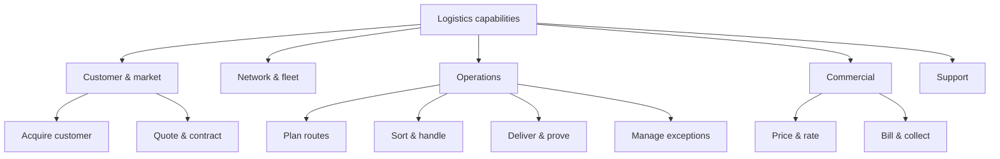

# Chapter 2 — Understanding the Business

## Learning objectives

By the end of this chapter you will be able to:

1. Explain your organization's business model in one page, in business language.
2. Read a profit and loss statement, a balance sheet, and a cash flow statement well enough to locate IT's effect on each.
3. Build a business capability map and use it to connect technology spend to business outcomes.
4. Trace one end-to-end business process and identify where technology helps, hinders, or hides.
5. Use unit economics to argue for or against a technology investment.
6. Run a thirty-day business immersion and produce a brief that a divisional director will recognize as accurate.

---

## Opening scenario: the number Priya could not explain

The Logistics divisional review was in its second hour when Tomás Ferreira put a chart on the screen. Cost per parcel, twelve quarters, trending gently downward, then flat.

"We need to take another forty cents out," he said. "Where can IT help?"

Priya had prepared. She had the application portfolio, the integration map, the warehouse management system upgrade plan. She began with the upgrade.

Tomás interrupted. "That's a system. I asked where you can help me take forty cents out of a parcel."

Priya looked at the chart. She knew the warehouse management system was old. She did not know what a parcel cost to move, which parts of that cost were labour, fuel, sortation, or failed delivery, or which of those IT could touch.

"Give me a week," she said.

"Take a week," Tomás said. "But come back with cents, not systems."

That evening Priya did something she had not done in eleven years: she asked to ride along with a delivery driver. She was on the van at 06:40 the next morning. By lunchtime she had seen the app fail twice at the same kind of address, watched a driver re-key a delivery because the barcode would not scan in low light, and learned that the difference between a good and a bad route was worth more than the entire IT budget for the mobile app.

She came back with cents. Three of them, in fact, and one of them had nothing to do with software.

---

## Core concepts

### 2.1 Why business literacy is the job

There are three reasons an IT manager must understand the business, and none of them is "to be well rounded."

**Prioritization.** Every portfolio decision is a comparison between business outcomes. Without a model of how the business makes money, you can only compare projects by cost, loudness of sponsor, or technical elegance. All three are wrong.

**Credibility.** Business leaders grant authority to people who understand the consequences of their proposals. A manager who can say "this reduces failed deliveries by two points, which is worth about €1.1m a year at current volume" is heard differently from one who says "this modernizes our platform."

**Value design.** The most valuable technology contributions do not automate an existing process; they change the economics of the business. You cannot see that opportunity without understanding the value chain, the unit economics, and the constraints.

The failure mode is the **translator trap**: you become fluent in both languages but never take a position. Translation is a service. Judgment is a role.

### 2.2 The business model on a page

A business model describes how an organization creates, delivers, and captures value. The Business Model Canvas (Osterwalder and Pigneur) remains the most practical one-page representation.

| Block | Question | Meridian Logistics example |
|---|---|---|
| **Customer segments** | Who do we serve? | Regional retailers, e-commerce merchants, manufacturers with inbound freight |
| **Value proposition** | Why do they choose us? | Next-day regional coverage, predictable delivery windows, integrated returns |
| **Channels** | How do we reach them? | Direct sales, freight brokers, API integration with merchant platforms |
| **Customer relationships** | How do we keep them? | Account management, SLA-backed contracts, self-service tracking |
| **Revenue streams** | How do we earn? | Per-parcel fees, per-pallet freight, warehousing fees, returns handling |
| **Key resources** | What must we have? | Depots, fleet, drivers, sortation equipment, routing software |
| **Key activities** | What must we do well? | Route planning, sortation, delivery, exception handling, billing |
| **Key partnerships** | Who do we depend on? | Subcontracted carriers, fuel suppliers, software vendors, customs brokers |
| **Cost structure** | Where does money go? | Driver labour, fuel, vehicle maintenance, depot rent, technology |

Two things follow immediately for an IT manager.

First, **technology appears in three blocks at once**: as a key resource (routing software), a key activity (exception handling), and increasingly a channel (API integration). A proposal that touches one block usually touches the others.

Second, **the cost structure tells you where technology can matter**. If driver labour is 45% of cost, an app that saves four minutes per stop is worth more than a data platform that improves reporting. If fuel is 20%, route optimization is the lever. If depot rent is 15%, inventory visibility and cross-docking matter.

**In practice:** write the canvas for your own organization in forty-five minutes, from memory. Then check it against the annual report. The gaps are your reading list.

### 2.3 Financial literacy: the three statements

You do not need an accounting qualification. You need to read three statements and know where IT lands in each.

#### The profit and loss statement (P&L)

Shows performance over a period: revenue, cost of goods sold, gross profit, operating expenses, EBITDA, depreciation and amortization, interest, tax, net profit.

What IT managers need from it:

- **Revenue and gross margin** — how much room the business has to fund change.
- **Operating expense lines** — where IT spend sits, and whether it is visible or buried in divisional costs.
- **EBITDA** — the number most boards and lenders watch; the reason capex-versus-opex choices matter politically.

#### The balance sheet

A snapshot at a point in time: assets, liabilities, equity.

What IT managers need from it:

- **Fixed assets** — capitalized software, hardware, and the depreciation that follows. A €3m capitalized platform is a €3m asset with a five-year tail.
- **Intangibles** — purchased software licences, goodwill from acquisitions.
- **Liabilities** — lease obligations, deferred revenue, and the accrued costs of contracts you have signed but not yet paid.
- **Working capital** — the gap between paying suppliers and being paid by customers. Technology that shortens order-to-cash improves it.

#### The cash flow statement

Shows actual movement of cash across operating, investing, and financing activities.

What IT managers need from it:

- **Timing.** A project that is profitable on paper can still starve the business if it consumes cash in the first year.
- **The opex/capex trade.** Cloud migration moves spend from investing (capex) to operating (opex). This improves cash flow in the short term and worsens EBITDA, which is why finance sometimes resists it and sometimes loves it.

#### Worked example: the same €3m, three ways

Meridian needs a new customer data platform. Three financing routes:

| | Buy and capitalize | Subscribe (SaaS) | Build in-house |
|---|---|---|---|
| Year 1 cash out | €3.0m capex | €1.0m opex | €2.4m (mostly staff) |
| Year 1 EBITDA impact | €0 (depreciation only) | −€1.0m | −€2.4m |
| Balance sheet | +€3.0m asset | none | +€2.4m capitalized |
| Year 3 cumulative cost | €3.0m + support | €3.1m | €4.2m incl. maintenance |
| Flexibility | Low | High | Lowest |
| Risk | Vendor lock-in | Price escalation | Key-person dependency |

The cheapest option on a three-year total cost basis is not the cheapest in year one, and the board may care about year one. Your job is not to pick the accounting treatment; it is to make the trade-off explicit so the choice is made by the person accountable for it.

**In practice:** for any proposal above your approval threshold, present three lines the CFO will look for — year-one cash, EBITDA impact, and three-year total cost — before any architecture diagram.

### 2.4 Value chain and capabilities

#### The value chain

Porter's value chain separates **primary activities** (which create and deliver the product) from **support activities** (which enable them).

For Meridian Logistics:

| Primary | Support |
|---|---|
| Inbound freight → sortation → line-haul → last-mile delivery → returns | Procurement, technology, HR, finance, facilities |

Map technology to each link, and mark whether it is *enabling* (makes the link work), *differentiating* (makes the link better than competitors), or *neutral* (necessary but not a source of advantage). Most IT spend is enabling or neutral. That is fine — but you should know which is which, because differentiating spend deserves different governance.

#### Business capability mapping

A capability is what the business can do, independent of how it does it. "Price a parcel" is a capability. The rating engine is one implementation.

A capability map is a two-level hierarchy, typically eight to twelve domains, each with five to fifteen capabilities. It is the single most useful artifact an IT manager can own, because it becomes the join between business strategy and technology investment.



For each capability, record four attributes:

| Attribute | Scale | Why it matters |
|---|---|---|
| **Strategic importance** | Low / medium / high | High-importance capabilities get investment and attention |
| **Current maturity** | 1–5 | Where the gap is |
| **Technology dependence** | Low / medium / high | Where IT can act |
| **Performance** | Below / at / above benchmark | Whether the gap is real |

Plot importance against maturity and you have a **capability heat map**: the top-right quadrant (high importance, low maturity) is your investment case, and the bottom-left (low importance, high maturity) is your rationalization case.

The template is in `templates/capability-heat-map.md`.

**In practice:** build the map with the business, not for it. A capability map produced by IT alone is a data model. One produced in a two-hour workshop with divisional leaders is a shared language, and shared language is what gets funding.

### 2.5 Core business processes

Capabilities describe *what*; processes describe *how*. Five processes appear in almost every organization, and each has a characteristic IT failure.

| Process | Starts with | Ends with | Typical systems | Common IT failure |
|---|---|---|---|---|
| **Order-to-cash** | Customer order | Cash received | CRM, order management, ERP, billing, payments | Order data re-keyed three times; invoicing errors; disputes |
| **Procure-to-pay** | Requisition | Supplier paid | Procurement, ERP, AP, expense | Maverick spend; no contract linkage; slow approval |
| **Record-to-report** | Transaction | Financial statements | ERP, consolidation, BI, close tools | Manual reconciliations; late close; no audit trail |
| **Hire-to-retire** | Requisition | Employee exit | HRIS, payroll, identity, learning | Joiner/mover/leaver errors; access not revoked |
| **Plan-to-produce** (or plan-to-deliver) | Demand signal | Fulfilment | Planning, MES/WMS, scheduling | Forecast disconnected from capacity; spreadsheet planning |

Choose one and trace it end to end. Count the handoffs, the systems, the manual re-keying, and the points where a customer waits. You will find more value in one day of process tracing than in a month of application portfolio analysis.

### 2.6 Unit economics and industry forces

#### Unit economics

Unit economics answer the question: *does one more unit of what we sell make money?*

| Business | Unit | Revenue per unit | Variable cost per unit | Contribution | Key lever |
|---|---|---|---|---|---|
| Logistics | Parcel | €4.20 | €3.65 | €0.55 | Drops per hour; failed-delivery rate |
| Retail store | Transaction | €38 | €26 | €12 | Basket size; footfall conversion |
| Retail online | Order | €52 | €44 | €8 | Returns rate; delivery cost |
| Lending | Loan | €1,850 interest | €1,180 (funding, credit losses, servicing) | €670 | Loss rate; origination cost |

Once you know the unit economics, technology proposals become arithmetic. A two-point reduction in failed deliveries on 40,000 parcels a day is 800 fewer redeliveries; at €6.50 each, that is €5,200 a day, or roughly €1.9m a year. Now you have a business case, and a number Tomás recognizes.

#### Industry forces

Porter's five forces applied to a division tell you where technology can change the competitive position:

| Force | Question | Technology implication |
|---|---|---|
| **Rivalry** | How intense is competition? | Price pressure favours cost-to-serve automation |
| **Buyer power** | Can customers switch easily? | Integration and switching costs become strategic |
| **Supplier power** | Do suppliers hold leverage? | Platform choices determine lock-in |
| **Threat of entry** | How easy is it to enter? | Digital channels lower barriers — for you and for rivals |
| **Substitutes** | What else solves the need? | Data and service bundles can differentiate |

For Meridian Retail, the entry of marketplace platforms is simultaneously a channel opportunity and a margin threat. That single observation should shape the e-commerce roadmap more than any technology trend report.

### 2.7 Reading the annual report in ninety minutes

The annual report is the cheapest business education available, and most IT managers never open it.

1. **Read the CEO letter (10 min).** What are the three priorities? What language is repeated? That language is what your proposals should echo.
2. **Read the segment note (15 min).** Revenue, margin, and growth by division. Where is the company actually making money?
3. **Read the risk section (20 min).** The risks the board discloses are the risks it will fund you to reduce. Compare them with your risk register.
4. **Read the technology and capital expenditure notes (15 min).** What has been invested, what is being depreciated, what is committed.
5. **Read the auditor's key matters (15 min).** These are the areas where the auditors see judgment and risk. They are often IT-adjacent: revenue recognition, impairment, IT controls.
6. **Skim the rest (15 min).** Note anything surprising and follow it up.

Then write five sentences: how the company makes money, where it is growing, where it is under pressure, what the board is worried about, and what that means for technology.

### 2.8 Shadow IT is market research

Tomás bought three SaaS tools without telling anyone. The instinct is to treat this as a governance failure. It is also a signal: the official channel was too slow, too expensive, or too disconnected from his need.

Ask three questions before you clamp down:

1. **What job was the tool hired to do?** If it is a real job, the demand will not disappear when you remove the tool.
2. **Why did the official route fail?** Cost, latency, or fit.
3. **Is this a capability we should provide properly?** If three divisions buy the same class of tool, you have a product opportunity.

Shadow IT is a symptom. Treating the symptom without the cause produces more careful shadow IT.

---

## Step-by-step method: the thirty-day business immersion

**Purpose:** move from "I know the technology estate" to "I understand the business the estate serves."
**Inputs:** annual report, divisional P&Ls, process owners, front-line staff, one day in the field.
**Outputs:** a two-page business context brief, a capability map, and three quantified opportunities.

### Step 1 — Read the numbers (days 1–3)

Annual report, latest board pack, divisional P&Ls. Extract revenue, margin, growth, and cost structure by division. Note where IT spend sits and whether it is visible. Write the five-sentence summary in 2.7.

### Step 2 — Map the value chain and capabilities (days 4–10)

Draft the value chain alone. Then run a two-hour workshop with each divisional leadership team to build the capability map. Ask: *which capabilities win or lose you business?* Mark strategic importance and current maturity. Do not debate definitions for more than ten minutes.

### Step 3 — Trace one process end to end (days 11–14)

Pick the process with the most customer contact and the most handoffs — usually order-to-cash. Walk it physically or observe it remotely. Record every system, every manual step, every wait, and every place data is re-entered. Time the customer's experience, not the department's.

### Step 4 — Interview five leaders with a fixed question set (days 15–20)

Same five questions, every time:

1. What are your three targets this year?
2. What stops you hitting them?
3. Where does technology help you most?
4. Where does it get in your way?
5. If you had €1m of my budget, what would you spend it on?

The last question is the most revealing. It tells you what the business thinks IT is for.

### Step 5 — Spend a day at the front line (days 21–25)

Warehouse, store, call centre, branch, depot. Watch, do not present. Ask "what do you do when the system is down?" and "what do you keep in a spreadsheet?" The answers are your risk register and your roadmap.

### Step 6 — Write and test the brief (days 26–30)

Two pages, no jargon:

1. **How we make money** — three sentences per division.
2. **Where we are under pressure** — margin, competition, regulation.
3. **The capabilities that matter** — top five, with maturity.
4. **Three quantified opportunities** — each with a unit-economic estimate.
5. **What I need to decide** — one clear ask.

Test it on one divisional director and one finance business partner. If either corrects a factual error, fix it and test again. When they stop correcting and start adding, you have earned the right to be listened to.

---

## Case study: Rolls-Royce and the engine that sells hours

**Context.** Rolls-Royce's civil aerospace business historically sold engines as products. Over several decades it shifted a large share of its business to **outcome-based service contracts** — most prominently **TotalCare**, under which the customer pays for engine availability and maintenance outcomes rather than for individual repairs. A related offering, "Power by the Hour," applies the same logic to corporate and regional aircraft.

**How it works.** Engines transmit operational data that feeds health monitoring and diagnostics. Rolls-Royce uses that data to plan maintenance, predict component wear, manage spare parts, and dispatch service teams. The contract transfers a defined portion of operational risk from the airline to the manufacturer. In its annual reporting the company has described services as roughly half of civil aerospace revenue and TotalCare as covering a large share of the installed base.

**Why it matters for an IT manager.** The business model and the technology are the same object.

1. **Data became a contractual obligation.** If the data feed fails, the service commitment is at risk. Data quality is not an analytics concern; it is a revenue concern.
2. **The operating model changed.** Outcome contracts require 24/7 global operations, spare-parts logistics, and service-level governance. That is an IT and operations problem before it is an engineering one.
3. **The economics changed.** Revenue moved from episodic (selling parts) to recurring (selling availability), which changed forecasting, working capital, and the risk profile. IT systems for billing, entitlement, and contract management had to follow.
4. **The customer relationship changed.** The airline's maintenance data and the manufacturer's systems are integrated. Integration depth became a competitive moat.

**Transferable lessons.**

- When your organization changes its revenue model, the systems that encode the old model become the binding constraint. Find them early.
- Ask of any data initiative: *which contract, obligation, or revenue line depends on this data being right?* If none, it is a hobby.
- Outcome-based models concentrate risk. Model the tail: what happens when the data is wrong, late, or missing?

**The counterpoint.** Outcome models are not universally better. They require the capability to price risk accurately and the balance sheet to absorb it. Several industrial firms that copied the model discovered that selling outcomes without the data and service capability is simply selling insurance at a loss.

---

## Templates and tools

### Business context brief (two pages)

```
BUSINESS CONTEXT BRIEF — [Division / Group]
Author: __________   Date: __________   Version: 1.0

1. HOW WE MAKE MONEY
   Revenue model: ______________________________________________
   Top three customer segments: _________________________________
   Gross margin: ____%   EBITDA margin: ____%   Growth: ____%

2. WHERE WE ARE UNDER PRESSURE
   Competitive: ________________________________________________
   Cost: ______________________________________________________
   Regulatory: _________________________________________________
   Customer behaviour: _________________________________________

3. CAPABILITIES THAT MATTER (top five)
   Capability            Importance  Maturity  Tech dependence
   1. _______________    H/M/L       1-5       H/M/L
   2. _______________    H/M/L       1-5       H/M/L
   3. _______________    H/M/L       1-5       H/M/L
   4. _______________    H/M/L       1-5       H/M/L
   5. _______________    H/M/L       1-5       H/M/L

4. UNIT ECONOMICS
   Unit: __________  Revenue/unit: ______  Variable cost/unit: ______
   Contribution/unit: ______  Most sensitive lever: ______________

5. THREE QUANTIFIED OPPORTUNITIES
   Opportunity            Mechanism              Annual value   Confidence
   1. ________________    ____________________   €__________    H/M/L
   2. ________________    ____________________   €__________    H/M/L
   3. ________________    ____________________   €__________    H/M/L

6. DECISION NEEDED
   ______________________________________________________________
```

### Worked example: Priya's three cents

Priya's brief for Logistics contained three opportunities, only one of which was a software project:

| Opportunity | Mechanism | Annual value | Confidence |
|---|---|---|---|
| Address-data quality and barcode scanning fix | Fewer failed deliveries and re-keys; 2.1 points fewer redeliveries on 9.6m parcels | ~€1.3m | High |
| Route sequencing change | Better sequencing in two depots; 3% fewer kilometres | ~€0.6m | Medium |
| Depot exception workflow | Faster resolution of damaged/lost claims; fewer credits | ~€0.4m | Medium |

The first was a data problem, not an application problem. The second was a process change that required no new software. The third was the only conventional IT project. Tomás funded all three, because each was expressed in cents.

---

## Pitfalls and checklist

### Common pitfalls

| Pitfall | Symptom | Correction |
|---|---|---|
| Learning the business from the IT side | You know the systems, not the value | Read the annual report; spend a day at the front line |
| Capability map built by IT alone | Beautiful, unused | Co-create with divisional leaders |
| Confusing capability with application | "Our CRM capability" | Name what the business can do, not what you bought |
| Ignoring unit economics | Business cases in percentages, not money | Convert every benefit to per-unit and annual value |
| Treating shadow IT as only a control issue | Clampdown, then more shadow IT | Diagnose the unmet need first |
| Over-reading benchmarks | "Best in class is 3.2%" | Benchmarks start conversations; your data ends them |
| Process mapping as an end | A wall of diagrams | Time the customer, count the handoffs, find the money |

### Pre-flight checklist

- [ ] I can explain each division's revenue model in three sentences.
- [ ] I know gross margin, EBITDA margin, and growth for each division.
- [ ] I have a capability map co-created with the business.
- [ ] I have traced one end-to-end process and counted the handoffs.
- [ ] I know the unit economics of the business I support.
- [ ] Every proposal I make includes a per-unit and an annual value.
- [ ] I have spent a day with front-line staff in the last six months.
- [ ] I know which three SaaS tools were bought without IT's involvement, and why.
- [ ] I can name the board's top three disclosed risks and how technology relates to each.
- [ ] My business context brief has been corrected by a divisional director.

---

## Key takeaways

1. **Business literacy is a delivery skill.** It changes what you prioritize, how you are heard, and what you can invent.
2. **Three statements, three questions.** Revenue and margin (can we fund change?), assets and liabilities (what have we committed?), cash (can we afford the timing?).
3. **Capabilities, not applications, are the join between strategy and technology.** Build the map with the business.
4. **Unit economics turns technology into arithmetic.** Cents per parcel beats percentages per platform.
5. **Trace a process before you redesign one.** Most value hides in handoffs and re-keying.
6. **Shadow IT is demand with bad packaging.** Diagnose before you control.
7. **Revenue-model changes break systems silently.** Find the contracts that depend on your data.

---

## Discussion questions

1. Write your organization's business model canvas from memory, then check it. What did you get wrong?
2. Which line of the P&L does your budget sit in, and who else is affected when it moves?
3. What is the unit economics of your business, and what is the most sensitive lever?
4. Which capability in your map is high-importance and low-maturity? Who owns the gap?
5. Where in your end-to-end process is data re-keyed? What does that cost per year?
6. What is the most expensive shadow IT tool in your organization, and what job is it doing?

---

## Further reading

- Osterwalder, A., and Pigneur, Y. *Business Model Generation.* Wiley, 2010. The canvas, and how to run it as a workshop.
- Porter, M. *Competitive Advantage.* Free Press, 1985. Value chain and five forces; still the clearest strategic grammar.
- Rolls-Royce Holdings, *Annual Reports* (civil aerospace segment and services disclosures). Primary source for the TotalCare case.
- Kaplan, R., and Norton, D. *The Balanced Scorecard.* Harvard Business School Press, 1996. Background for connecting capability to measures (applied in Chapter 15).
- Magretta, J. *Understanding Michael Porter.* Harvard Business Review Press, 2011. The most readable guide to Porter's ideas.
- Ward, J., and Peppard, J. *Strategic Planning for Information Systems.* Wiley, 2002. The applications portfolio model used in Chapter 3.
