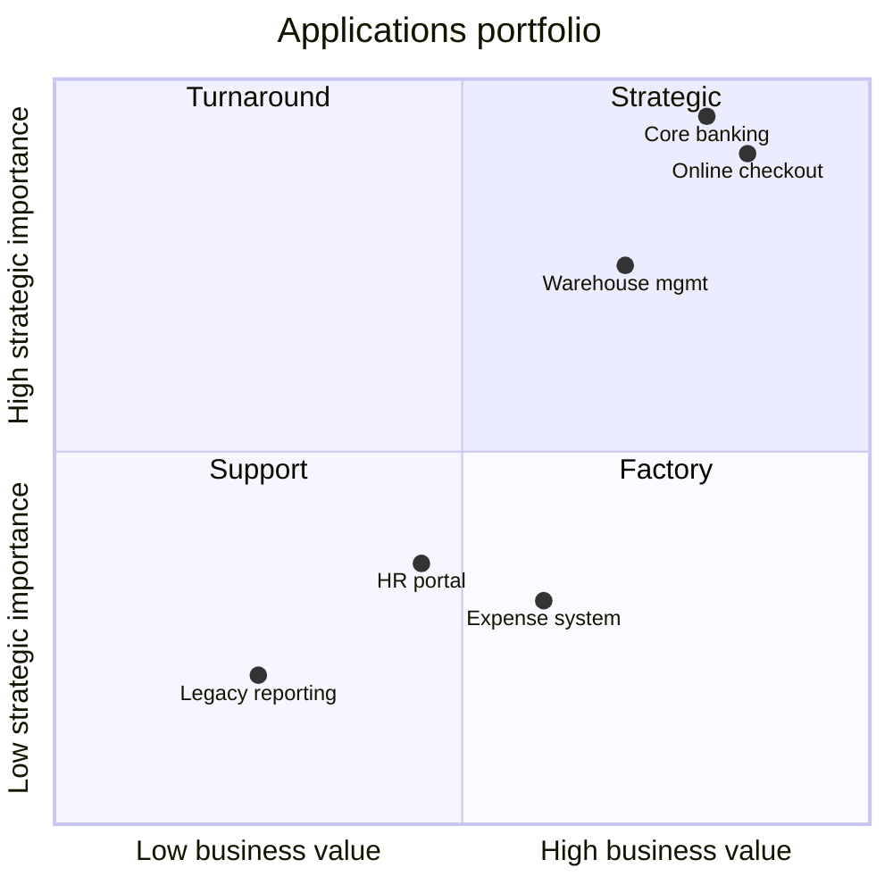

# Chapter 3 — IT Strategy and Strategic Planning

## Learning objectives

By the end of this chapter you will be able to:

1. Distinguish strategy from planning, and explain why most IT strategies are neither.
2. Write a strategy in the form of a diagnosis, a guiding policy, and coherent actions.
3. Choose where IT will play and how it will win, using the business strategy as the starting point.
4. Use the applications portfolio and capability models to decide what to invest in, sustain, replace, or retire.
5. Build a one-page strategy and a three-horizon roadmap that fit within a real budget and a real team.
6. Run a twelve-week annual strategy cycle that ends with funded decisions, not a document.
7. Set outcome measures that survive contact with a quarterly review.

---

## Opening scenario: forty initiatives and one page

Priya's first strategy offsite produced forty-one initiatives.

They came from the right places: divisional demand, audit findings, the cloud migration, the e-commerce ambition, the AI pilot Ravi wanted, the core banking upgrade nobody could postpone forever, and a list of "quick wins" assembled by the PMO. Each had a sponsor. Each had a reason. Several had a business case.

Marcus Feld read the list twice. "This is not a strategy," he said. "It's a wish list with a budget attached. If everything is a priority, I have no way to cut anything, which means I will cut by percentage, which means you will lose the things you care about most."

Elena Voss was more concise. "One page. By the next board. Tell me what we are doing, what we are not doing, what it costs, and what I get."

Priya spent the next three weeks doing the hardest intellectual work of her career: deciding what not to do. Thirty-one initiatives were deferred, merged, or killed. Three were reclassified as business-as-usual and funded from run budgets. Seven survived, in a sequence, with a number attached to each.

The board approved it in eleven minutes. Not because it was clever, but because it was a choice.

---

## Core concepts

### 3.1 What strategy is, and what it is not

A strategy is an integrated set of choices about where to play, how to win, and what to stop doing, made under uncertainty, with resources that are insufficient to do everything.

Richard Rumelt's formulation is the most useful for IT managers, because it forces the thinking before the formatting:

> **The kernel of good strategy:** (1) a **diagnosis** of the situation, (2) a **guiding policy** for dealing with it, and (3) a set of **coherent actions** designed to carry out the policy.

Test any strategy document against those three. Most fail at the first: they describe aspirations ("become a digital leader") rather than diagnose a situation ("our order-to-cash cycle is nine days longer than competitors', and 60% of that delay is manual credit checks").

| Not strategy | Why it fails |
|---|---|
| A list of initiatives | No choices; no explanation of why these and not others |
| A technology roadmap | A sequence of projects, not a theory of advantage |
| A maturity model target | "Reach level 4 in COBIT" is a means, not an end |
| A vision statement | Aspiration without diagnosis or resource allocation |
| A budget | Money without logic |
| A vendor's reference architecture | Someone else's strategy |

Strategy is also not planning. Planning allocates known resources to known work. Strategy decides which work deserves resources in the first place. You need both, in that order.

### 3.2 Three levels, one direction

| Level | Question | Owner | Horizon |
|---|---|---|---|
| **Business strategy** | Where do we compete, and how do we win? | CEO and executive team | 3–5 years |
| **IT strategy** | How will technology and information create and protect that advantage? | CIO / IT director | 2–3 years |
| **Technology strategy** | Which platforms, architectures, and standards will we use? | CTO / chief architect | 1–3 years |

IT strategy is subordinate to business strategy in direction, but not in ambition. The best IT strategies do two things at once: **align** with the business's stated direction, and **propose** capabilities the business has not yet imagined. Alignment alone produces a service function. Proposal alone produces the GE Digital problem from Chapter 1.

Ward and Peppard's distinction is useful here:

- **IS strategy** — what information and applications the business needs, and the benefits it expects. Business-led.
- **IT strategy** — how technology, infrastructure, and skills will be supplied. Technology-led.
- **Information systems strategy** — the combined demand and supply plan.

Most "IT strategy" documents are supply plans. They describe infrastructure and platforms. They do not describe what the business will be able to do that it cannot do today.

### 3.3 Where the evidence comes from

A strategy built from opinion is a preference. Build it from six sources:

1. **The business strategy and its numbers.** Targets, growth assumptions, margin pressure, divestments, acquisitions.
2. **Capability gaps.** From the Chapter 2 map: high importance, low maturity.
3. **Demand.** What the business is asking for, including the shadow IT signals.
4. **Risk and obligation.** Audit findings, regulatory deadlines, contractual commitments, single points of failure.
5. **Cost and performance.** Run cost per unit, benchmark gaps, licence exposure, technical debt interest.
6. **External change.** Customer behaviour, competitor moves, regulation, technology maturity.

For each source, write one page of findings. Then look for the pattern: the three or four facts that, taken together, define the situation. That is your diagnosis.

**In practice:** the diagnosis should make someone uncomfortable. If it could have been written three years ago, it is not a diagnosis; it is a description.

### 3.4 Frameworks worth using (and how to use them)

#### SWOT and TOWS

SWOT is popular because it is easy. It is weak because it produces lists rather than choices. Use it only as an input, then convert it with TOWS:

| | **Strengths** | **Weaknesses** |
|---|---|---|
| **Opportunities** | **SO:** use strength to seize opportunity | **WO:** acquire capability to seize opportunity |
| **Threats** | **ST:** use strength to defend | **WT:** avoid or mitigate |

Each cell should produce at most two strategic options. If it produces ten, you are listing, not strategizing.

#### Value disciplines

Treacy and Wiedema argue that market leaders excel at one of three disciplines and meet threshold standards in the other two:

| Discipline | Promise | IT implications |
|---|---|---|
| **Operational excellence** | Lowest total cost, reliability, no surprises | Automation, straight-through processing, supply-chain integration, cost transparency |
| **Product leadership** | Best product, fastest innovation | Engineering capability, platform reuse, rapid experimentation, telemetry |
| **Customer intimacy** | Best total solution for a defined segment | Data integration, segmentation, personalization, service tooling |

Choosing a discipline tells you where to spend the marginal euro. A company claiming all three is claiming it has no strategy.

For Meridian Retail, the stated goal — online revenue to 30% of sales — is a customer-intimacy and operational-excellence play, not a product-leadership play. That single classification should reorder the roadmap: conversion, fulfilment accuracy, and returns handling before shiny store technology.

#### The applications portfolio

Ward and Peppard's grid classifies applications by **strategic importance** and **business value/quality**, producing four categories with different investment postures:



| Quadrant | Characteristics | Posture |
|---|---|---|
| **Strategic** | High importance, high value | Invest, differentiate, protect, staff with best people |
| **Turnaround** | High importance, low value | Fix or replace urgently; this is where failure hurts most |
| **Factory** | Low importance, high value | Run efficiently; standardize; do not gold-plate |
| **Support** | Low importance, low value | Rationalize, consolidate, or retire |

The grid's value is not precision; it is forcing a different conversation for each quadrant. Strategic applications should not be managed by the same cost-cutting logic as support applications, and support applications should not consume your best engineers.

#### Capability-based planning

Translate each strategic choice into the capabilities it requires, the gap between current and required maturity, and the initiatives that close the gap. This is the bridge from strategy to roadmap.

| Strategic choice | Capability required | Current | Target | Initiative |
|---|---|---|---|---|
| Grow online to 30% | Fulfil from store | 2 | 4 | Distributed order management |
| Grow online to 30% | Returns handling | 1 | 3 | Returns portal and reverse logistics |
| Cut logistics cost 12% | Route optimization | 3 | 4 | Sequencing engine upgrade |
| Reduce group cost €40m | Cost transparency | 2 | 4 | IT and shared-service chargeback |

#### Maturity models: use with care

CMMI, COBIT, and ITIL maturity models are useful for describing a trajectory and benchmarking a function. They are dangerous as goals, for three reasons:

1. **Maturity is not value.** A level 4 process for something the business does not care about is waste.
2. **They measure practice, not outcome.** You can be mature and slow.
3. **They invite box-ticking.** Assessments become the deliverable.

Use maturity models to answer "what would good look like here?" and to sequence improvement. Do not put "reach level 4" in a board paper without a business consequence attached.

### 3.5 From diagnosis to choices

#### The strategy kernel, applied

**Diagnosis.** Meridian's online channel is growing at 40% but fulfilment is manual, returns are 24% of orders, and the cost to serve online is 30% higher than in store. Meanwhile 62% of IT run spend goes to applications that support less than 15% of revenue, and the core banking batch has a single-person dependency. The board wants growth and cost reduction simultaneously; the current portfolio cannot deliver both.

**Guiding policy.** Concentrate investment on the three capabilities that determine online profitability — fulfilment, returns, and payment — while reducing run cost through rationalization and cloud economics; protect the regulated core with a separate, ring-fenced resilience programme; do not start new platform initiatives in the planning year.

**Coherent actions.** Seven initiatives, sequenced, funded, each with an owner and a measure. Stop four programmes. Reclassify three.

Notice what the policy does: it says no. A guiding policy that permits everything is not a policy.

#### Where to play, how to win — for IT

Adapted from Lafley and Martin's strategy choice cascade:

| Question | IT translation |
|---|---|
| **What is our winning aspiration?** | What business outcome will technology make possible? |
| **Where will we play?** | Which divisions, capabilities, customer journeys, and geographies? |
| **How will we win?** | Cost, speed, reliability, insight, or experience — pick the basis of advantage |
| **What capabilities must be in place?** | Platforms, data, skills, partnerships, governance |
| **What management systems are required?** | Funding model, portfolio governance, metrics, talent processes |

The third question is the one IT strategies most often skip. "How will we win?" forces a comparative claim: faster than whom, cheaper than what, more reliable than which alternative. Without it, every initiative looks equally justified.

### 3.6 The one-page strategy

A one-page strategy is not a summary of a longer document. It is the document, and the longer material is supporting evidence.

Structure:

```
1. SITUATION (diagnosis)        3–5 sentences, factual, uncomfortable
2. AMBITION                     1 sentence, outcome-based, dated
3. HOW WE WILL WIN              2–3 choices, with the trade-off named
4. WHAT WE WILL DO              5–7 initiatives, sequenced, with owners
5. WHAT WE WILL STOP            explicit list
6. WHAT IT COSTS                envelope, by year, by division
7. HOW WE WILL KNOW            3–5 outcome measures, baselines, targets
8. WHAT WE NEED                 decisions, money, people, permissions
```

The page should survive being read by a director in ninety seconds and by a CFO in five minutes. If it needs a cover slide, it is not finished.

A fillable template is in `templates/strategy-on-a-page.md`.

### 3.7 The roadmap: three horizons

Strategy sets direction; the roadmap sets sequence. Use three horizons to prevent the roadmap from becoming a five-year fiction.

| Horizon | Timeframe | Nature | Funding | Governance |
|---|---|---|---|---|
| **H1 — Run and improve** | 0–12 months | Known work, committed outcomes | Base budget | Delivery governance |
| **H2 — Build** | 6–24 months | Defined initiatives with business cases | Investment budget | Stage gates |
| **H3 — Explore** | 12–36 months | Options, experiments, technology bets | Small, ring-fenced | Portfolio review, kill criteria |

Most IT roadmaps fail because they are all H2: a long list of projects with no H1 capacity reserved and no H3 learning. The result is a plan that assumes 100% of the team is available for change, which is never true.

**Sequencing rules that work in practice:**

1. **Dependency before desire.** Sequence by what unlocks what, not by sponsor enthusiasm.
2. **Capacity before commitment.** Reserve 30–40% of delivery capacity for unplanned work and run obligations.
3. **Value early.** Put one visible, measurable win in the first two quarters. Strategy needs proof to survive.
4. **Risk first where irreversible.** Regulatory and resilience work does not wait for convenience.
5. **Stop before you start.** Every new initiative needs a named thing that stops, or an explicit capacity increase.

### 3.8 OKRs and outcome measures

Objectives and Key Results (OKRs) work when the key results are outcomes, not activities.

| Bad key result | Why | Better key result |
|---|---|---|
| "Launch the new checkout" | Activity; no outcome | "Increase checkout completion from 61% to 68% by Q4" |
| "Migrate 40% of workloads to cloud" | Activity; migration is not a benefit | "Reduce infrastructure cost per transaction by 15% while holding availability at 99.9%" |
| "Implement zero trust" | Programme name | "Reduce standing privileged accounts from 340 to under 60" |
| "Improve data quality" | Unmeasurable | "Reduce customer master duplicates from 12% to under 2%" |

Three rules:

- **Every key result has a baseline and a date.** Without a baseline, you cannot claim improvement.
- **No more than five objectives.** More than five means you have not chosen.
- **Separate health metrics from change metrics.** Availability and incident rates are health; they belong in service reviews, not OKRs, unless they are the strategic problem.

**In practice:** write the measure before the initiative. If you cannot, you do not yet know what the initiative is for.

### 3.9 Funding the strategy

A strategy without money is a wish. Three funding patterns, and when each fits:

| Pattern | How it works | Fits when | Risk |
|---|---|---|---|
| **Annual envelope** | One negotiated budget, allocated quarterly | Stable business, mature governance | Slow to reallocate; annuality |
| **Portfolio funding** | Persistent teams funded against outcomes, reviewed quarterly | Product-oriented, continuous delivery | Requires mature product management |
| **Stage-gated investment** | Funds released at evidence points | High uncertainty, large bets | Can become bureaucratic; favours safe projects |

Whichever you use, the strategy must state the **envelope** and the **trade rule**: what gets cut first if the envelope shrinks by 15%. If you cannot answer that question in advance, you will answer it badly under pressure.

### 3.10 The annual cycle

| Weeks | Activity | Output | Who |
|---|---|---|---|
| 1–2 | Business strategy refresh; collect targets and constraints | Business context brief | IT leadership + finance |
| 3–4 | Evidence gathering: capability gaps, risk, cost, demand | Findings pack | IT leadership |
| 5–6 | Diagnosis workshop; agree the three or four facts | Diagnosis statement | IT leadership + divisional leads |
| 7 | Choices workshop: where to play, how to win, what to stop | Draft strategy on a page | IT director + CEO/CFO |
| 8 | Initiative shaping: owners, costs, measures, dependencies | Initiative one-pagers | Initiative owners |
| 9 | Challenge session with finance and risk | Costed, risk-assessed portfolio | CFO, risk, IT |
| 10 | Prioritization and sequencing; capacity check | Roadmap, three horizons | IT leadership |
| 11 | Executive review and approval | Approved strategy and envelope | ExCo / board |
| 12 | Communication and cascade; update OKRs | Published strategy, team briefings | IT director |

Twelve weeks is not a luxury; it is the minimum for a strategy that survives scrutiny. Organizations that compress this into a two-day offsite get a document that is forgotten by March.

---

## Step-by-step method: building the strategy in six steps

**Purpose:** produce a one-page, funded, measurable IT strategy in one quarter.
**Inputs:** business strategy, capability map, cost baseline, risk register, demand list.
**Outputs:** strategy on a page, roadmap, funding envelope, OKR set, stop list.

### Step 1 — Write the diagnosis (2 weeks)

Gather the six evidence sources from 3.3. Write no more than five sentences that state what is true, what is changing, and why the current trajectory fails. Circulate to three people who will disagree with you. Revise until the disagreement is about the response, not the facts.

### Step 2 — Set the ambition and the basis of advantage (1 week)

One sentence for the ambition, dated and measurable. Then answer "how will we win?" with two or three comparative claims. Name the trade-off each claim implies. If there is no trade-off, there is no strategy.

### Step 3 — Choose where to play (2 weeks)

Using the capability map and applications portfolio, select the capabilities that receive investment. For each, state the current and target maturity and the business outcome. Then produce the stop list: applications to retire, programmes to cancel, demand to decline. The stop list is the hardest page and the most credible.

### Step 4 — Shape and cost the initiatives (2 weeks)

Five to seven initiatives. For each: owner, outcome measure with baseline, cost by year, dependencies, key risks, and the first evidence point. Reject any initiative without an owner who has signed up and a measure that can move within four quarters.

### Step 5 — Sequence against capacity (1 week)

Build the three-horizon roadmap. Check that H1 plus run obligations consume no more than 60–70% of delivery capacity. Identify the critical path and the two most likely points of failure. Add a stop rule for each H3 bet.

### Step 6 — Approve, publish, and govern (2 weeks)

Take the one page to the executive team with a single ask: approve the envelope and the stop list. Publish it to IT in a single all-hands, in plain language. Put it on the agenda of the quarterly portfolio review, where the question is always: *is the strategy still right, and are we still funding it?*

---

## Case study: Adobe's deliberate cannibalization

**Context.** In 2011 Adobe earned most of its revenue from perpetual licences to Creative Suite — Photoshop, Illustrator, InDesign, and related products — sold in periodic upgrade cycles. Revenue was lumpy, piracy was significant, and customers delayed upgrades. At its MAX conference in October 2011, Adobe announced Creative Cloud, a subscription offering. In May 2013 it announced that future versions of Creative Suite would be available only through Creative Cloud.

**What happened.** The transition was brutal in the short term. Revenue fell from $4.40 billion in FY2012 to $4.06 billion in FY2013, and the share price fell sharply as investors priced in the loss of high-margin licence revenue. Adobe continued to invest, and the subscription base grew. By FY2015 revenue had recovered to $4.80 billion, and recurring revenue had become the majority of the business; in later years digital media annualized recurring revenue became the company's central metric. Adobe also had to rebuild the operational backbone: entitlement, identity, subscription billing, usage telemetry, and customer success.

**Why it matters for an IT manager.** This was a business-model change that only technology could execute, and it required IT to work differently in four ways.

1. **New revenue mechanics.** Subscription billing, proration, renewals, refunds, and revenue recognition are materially more complex than shipping a licence. Finance and IT had to co-design the model.
2. **Identity became revenue-critical.** If a customer cannot sign in, they cannot use the product they are paying for. Identity moved from a support function to a revenue system.
3. **Telemetry became a management system.** Knowing who uses what, how often, and where they drop off is how a subscription business manages churn.
4. **The transition had to be communicated honestly.** Adobe told investors the short-term numbers would get worse. That permission was essential; without it, the first bad quarter would have ended the strategy.

**Transferable lessons.**

- Some strategies require cannibalizing current revenue. Say so explicitly, and get explicit permission for the dip.
- When the business model changes, the systems that encode the old model become the binding constraint. Find them in the diagnosis, not in year two.
- Choose the measure that matches the new model. For Adobe it was ARR; for you it may be cost per transaction, adoption, or retention.
- A strategy that cannot survive two bad quarters is not a strategy; it is a forecast.

---

## Templates and tools

### Strategy on a page

```
IT STRATEGY ON A PAGE — [Organization]
Version: ____   Owner: ____   Approved: ____   Review: ____

1. SITUATION
   ______________________________________________________________
   ______________________________________________________________

2. AMBITION (outcome, dated)
   By __________ we will ________________________________________

3. HOW WE WILL WIN
   1. __________________________________________________________
   2. __________________________________________________________
   Trade-off we accept: _________________________________________

4. WHAT WE WILL DO (5–7, sequenced)
   #  Initiative        Owner     Outcome measure      Cost    Horizon
   1  ______________    _______   _________________    €____   H1/H2/H3
   2  ______________    _______   _________________    €____   H1/H2/H3
   3  ______________    _______   _________________    €____   H1/H2/H3

5. WHAT WE WILL STOP
   - ______________________  - ______________________

6. COST
   Year 1: €______   Year 2: €______   Year 3: €______
   Funded from: ________________________________________________

7. HOW WE WILL KNOW
   Measure              Baseline    Target      By when
   __________________   ________    ________    ________
   __________________   ________    ________    ________

8. WHAT WE NEED
   Decision: ____________________________________________________
```

### Worked example: Meridian's first strategy page (extract)

| Element | Content |
|---|---|
| **Situation** | Online grows 40% but costs 30% more to serve than store; 62% of run spend supports under 15% of revenue; core banking batch has a single-person dependency; the board wants growth and €40m cost reduction in the same three years. |
| **Ambition** | By the end of year three, online is 30% of retail revenue at or below store-level contribution margin, and group IT run cost is 18% lower in real terms. |
| **How we win** | Fulfilment speed and accuracy in Retail; cost-to-serve leadership in Logistics; ring-fenced resilience in Financial Services. Trade-off: we defer store technology refresh for two years. |
| **What we do** | 1. Distributed order management (H1–H2) · 2. Returns and reverse logistics (H2) · 3. Route sequencing upgrade (H1) · 4. Core banking DR and batch de-risking (H1) · 5. Application rationalization, 22 systems to 14 (H1–H2) · 6. Cloud landing zone and migration wave 2 (H2) · 7. Cost transparency and chargeback (H1) |
| **What we stop** | Store refresh programme; two reporting tools; the innovation lab; three divisional shadow SaaS contracts |
| **Cost** | €11m capex year 1, €9m year 2, €7m year 3; run cost down €4m by year 3 |
| **Measures** | Online contribution margin; cost per parcel; P1 incidents; run cost per employee; DR test pass rate |

---

## Pitfalls and checklist

### Common pitfalls

| Pitfall | Symptom | Correction |
|---|---|---|
| Strategy as a document | 60 pages, no decisions | One page, one ask, one stop list |
| No diagnosis | Aspirational opening; could be from any year | Three uncomfortable facts with numbers |
| Everything is priority | 40 initiatives | Force rank; fund seven; name what stops |
| Ignoring capacity | Plan assumes 100% availability | Reserve 30–40% for run and unplanned work |
| Measures are activities | "Deliver X" | Baseline, target, date, business outcome |
| No funding link | Strategy approved, budget unchanged | Envelope and trade rule in the paper |
| Trend-driven | AI, blockchain, metaverse in the same roadmap | Every bet has a customer, a use case, a kill criterion |
| Annual only | Strategy reviewed once, then abandoned | Quarterly review with a standing re-prioritization question |
| Vendor-shaped | Roadmap mirrors a vendor's product suite | Start from capability gaps, then choose products |

### Pre-flight checklist

- [ ] The diagnosis contains at least three facts that could be wrong, and are not.
- [ ] The ambition is dated and measurable.
- [ ] There are two or three explicit choices, each with a named trade-off.
- [ ] There are no more than seven initiatives, each with an owner and a measure.
- [ ] There is a stop list, and it is not empty.
- [ ] The plan fits within a stated envelope and a capacity check.
- [ ] Every H3 bet has a kill criterion.
- [ ] Every measure has a baseline and a review date.
- [ ] The one page has been read by the CFO and the CEO before the board.
- [ ] The strategy is on the agenda of a quarterly review, with the power to change it.

---

## Key takeaways

1. **Strategy is choice under scarcity.** If nothing is excluded, nothing has been decided.
2. **Diagnosis, policy, actions.** Rumelt's kernel is the cheapest quality check available.
3. **Align and propose.** A strategy that only serves stated demand will never create advantage.
4. **Capabilities are the bridge.** From business choice to technology investment, via capability gaps.
5. **Portfolios need different postures.** Strategic, turnaround, factory, and support applications should not be managed with one rule.
6. **Sequence against capacity, not enthusiasm.** Reserve 30–40% of delivery for reality.
7. **Measures before initiatives.** If you cannot state the outcome, you do not yet have a project.
8. **Funding is the proof.** A strategy without an envelope and a trade rule is a wish.

---

## Discussion questions

1. Write your organization's diagnosis in five sentences. Would a skeptical CFO accept the facts?
2. What is your "how will we win?" claim, and what trade-off does it force?
3. Which applications in your portfolio are in the turnaround quadrant? Who owns fixing them?
4. What would you stop tomorrow if you had the authority? What is stopping you?
5. Which of your key results are activities disguised as outcomes?
6. If your budget were cut by 15%, what would you protect, and does your strategy say so in advance?
7. Where has a revenue-model or business-model change broken an assumption in your systems?

---

## Further reading

- Rumelt, R. *Good Strategy Bad Strategy.* Crown Business, 2011. The kernel, and the clearest diagnosis of bad strategy available.
- Lafley, A. G., and Martin, R. *Playing to Win.* Harvard Business Review Press, 2013. The strategy choice cascade adapted in 3.5.
- Treacy, M., and Wiedema, F. *The Discipline of Market Leaders.* Addison-Wesley, 1995. Value disciplines.
- Ward, J., and Peppard, J. *Strategic Planning for Information Systems.* Wiley, 2002. IS/IT strategy distinction and the applications portfolio.
- Doerr, J. *Measure What Matters.* Portfolio, 2018. OKRs in practice, with useful failure modes.
- Adobe, *Annual Reports FY2012–FY2015* and the May 2013 Creative Cloud announcement. Primary sources for the Adobe case.
- Kaplan, R., and Norton, D. *Strategy Maps.* Harvard Business School Press, 2004. Converting strategy into linked measures.
